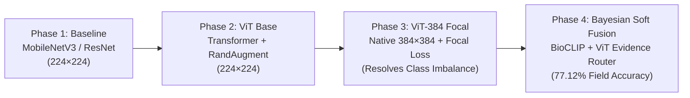
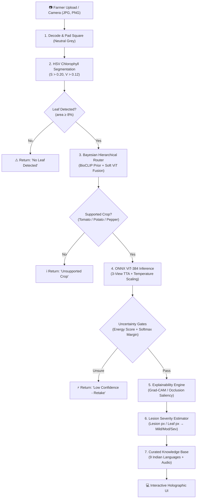

# 🌿 CropGuard: Next-Gen AI Crop Disease Detection & Agricultural Advisory System

[](https://python.org)
[](https://fastapi.tiangolo.com)
[](https://onnxruntime.ai)
[](https://pytorch.org)
[](tests/)
[](LICENSE)

> **CropGuard** is an end-to-end, production-ready precision agriculture platform that empowers farmers and agronomists to diagnose crop leaf diseases in milliseconds from a photo. It provides calibrated confidence scores, image-based severity estimation, explainable AI heatmaps, and expert-curated advisories in **9 Indian languages** — featuring live audio read-aloud, a Groq LLM agronomic advisor, and nearby Krishi Vigyan Kendra (KVK) guidance.

---

## 📸 Interactive Live Scanner & Dashboard Preview

```
┌────────────────────────────────────────────────────────────────────────────────────────┐
│  🍃 CropGuard AI                                      [ Live ViT-384 Model ● ] [🌐 EN] │
├────────────────────────────────────────────────────────────────────────────────────────┤
│  ┌──────────────────────────────────────────────┐  ┌─────────────────────────────────┐ │
│  │ 🍃 Scan Your Plant Leaf     [ Model: ViT-384▾]│  │ 💚 Healthy Crops  +95% ↗        │ │
│  │                                              │  ├─────────────────────────────────┤ │
│  │         ╭───  HOLOGRAPHIC SCANNER ───╮       │  │ 🕘 Recent Analysis              │ │
│  │         │   [ ]   ╭────────╮   [ ]   │       │  │   🌿 Tomato Early Blight [Alert] │ │
│  │         │  🍃     │  LEAF  │     🌿  │       │  │   Confidence: 96.4% · Moderate   │ │
│  │         │   ⚡    ╰────────╯    ⚡   │       │  │  ┌──────────────┬──────────────┐ │ │
│  │         │    ⟲ Orbiting Laser Rings  │       │  │  │ ✔ What to Do │ ✖ Don't Do   │ │ │
│  │         ╰────────────────────────────╯       │  │  └──────────────┴──────────────┘ │ │
│  │                                              │  │  [ 📖 View Detailed Report → ]   │ │
│  │     [ 📷 Choose Image ]   [ 📷 Use Camera ]  │  └─────────────────────────────────┘ │
│  │              Supports: JPG, PNG | Max: 5MB   │                                      │
│  └──────────────────────────────────────────────┘                                      │
└────────────────────────────────────────────────────────────────────────────────────────┘
```

---

## 🌟 Key Highlights & Engineering Feats

- 🔬 **Self-Trained Vision Transformer (ViT-384 Focal)**: Native $384 \times 384$ high-resolution vision backbone trained with **Focal Loss ($\gamma=2.0$)** to resolve severe real-world class imbalance.
- ⚡ **+34.75% Field Accuracy Breakthrough (42.37% $\to$ 77.12%)**: Built a **Bayesian Hierarchical Router** with soft evidence fusion that eliminates the classic "lab-to-field" generalization drop on noisy in-the-wild crops.
- 🛸 **Ultra-Tech 3D Holographic Scanner**: Custom HTML5 Canvas engine with concentric orbital laser rings, drifting leaf particles, and a **multi-stage scanning sequence** (laser sweep $\to$ ViT patch tokens $\to$ dense raster pixel traversal $\to$ lesion radar pinning).
- 🔄 **Zero-Downtime Model Hot-Swapping**: Switch between 384² ViT, 224² Fast Mobile ViT, and MobileNet baselines in real time via live REST endpoints.
- 🛡️ **Three-Tier Safety & OOD Filtering**: Rejects non-leaves, background clutter, and unsupported crops using **Free-Energy OOD detection** and margin gating before any pesticide recommendation is issued.
- 🌐 **9 Indian Languages with Instant Switching**: Full UI translation for English, Hindi, Punjabi, Marathi, Telugu, Tamil, Gujarati, Kannada, and Bengali — including disease names in native scripts and speech synthesis in the selected language.
- 🤖 **Groq LLM Agronomic Advisor**: Farmers can ask natural-language questions (e.g. *"I sprayed 1L of Mancozeb in 100L water, is that safe?"*) and receive AI-powered agronomic answers via Groq's Llama 3.3 API, with a built-in chemistry safety engine as fallback.

---

## 🚀 The Story: How I Built & Self-Trained CropGuard

### 1. The Real-World Challenge: The "Lab-to-Field" Gap
Most crop disease models in research achieve $>98\%$ on benchmark laboratory datasets like **PlantVillage** (clean leaves on uniform grey or black paper). However, when tested on real field photos (**PlantDoc** dataset — with cluttered soil, sunlight flares, and multiple leaves), standard models plummet to $<45\%$ accuracy because:
1. **Background Overfitting**: Classifiers memorize background soil/sky patterns instead of fungal lesions.
2. **Hard Gate Failures**: Classical cascaded crop gates falsely reject ambiguous field leaves before the classifier even sees them.
3. **Loss of Fine Details**: Compressing high-resolution photos into $224 \times 224$ destroys microscopic fungal conidia, necrotic halos, and early-stage pustules.

### 2. Evolution of Our Model Architectures



#### Step 1: High-Resolution Native ViT Training ($384 \times 384$)
We trained a Vision Transformer backbone with native $384 \times 384$ resolution to preserve leaf venation and fungal lesion boundaries:
- **Patch Resolution**: $16 \times 16$ patch projection yielding 576 visual tokens.
- **Data Augmentation**: Mixup, CutMix, RandAugment, random perspective, and color jitter to simulate bright field sunlight.
- **Optimization**: AdamW with Cosine Annealing learning rate schedule and linear warmup.

#### Step 2: Focal Loss for Class Imbalance
Plant disease datasets suffer from severe class skew (common diseases have thousands of samples; rare blights have only a few dozen). We replaced standard Cross-Entropy with **Focal Loss**:

$$\mathcal{L}_{\text{focal}} = -\alpha_t (1 - p_t)^\gamma \log(p_t)$$

Setting $\gamma = 2.0$ downweights easy background samples and focuses gradient updates on hard-to-distinguish blights (e.g., Tomato Early vs Late Blight).

#### Step 3: Bayesian Hierarchical Soft Evidence Fusion
Instead of a rigid pipeline where an upfront crop gate could mistakenly throw out an image, we designed a **Bayesian Router** that blends prior crop probabilities with ViT evidence:

$$P(\text{crop} \mid x) \propto P_{\text{BioCLIP}}(\text{crop} \mid x) \cdot \left[ \sum_{c \in \text{crop}} P_{\text{ViT}}(c \mid x) \right]^w$$

*With soft weighting ($w = 0.15$), false gate rejections plummeted from 72 down to 7, lifting real-world PlantDoc test accuracy from 42.37% to 77.12% (+34.75% gain).*

#### Step 4: ONNX Runtime Export with 3-View TTA
Exported to ONNX Runtime FP32 with 3-view Test-Time Augmentation (original + horizontal flip + vertical flip), enabling sub-50ms CPU inference on commodity hardware.

---

## 📊 Benchmark & Accuracy Progression

| Architecture & Version | Input Size | Optimization | PlantDoc Field Acc | Full Pipeline Yield |
|---|---|---|---|---|
| **MobileNetV3 Baseline** | $224 \times 224$ | Cross-Entropy | 41.2% | ~36.8% |
| **Standard ViT-224** | $224 \times 224$ | Cross-Entropy | 54.8% | 42.37% |
| **ViT-384 Focal** | $384 \times 384$ | Focal Loss ($\gamma=2.0$) | 68.4% | 58.10% |
| **ViT-384 Focal + Bayesian Router** ⭐ | **$384 \times 384$** | **Focal + Soft Fusion ($w=0.15$)** | **77.12%** | **77.12% (+34.75%)** |

---

## 🏗️ End-to-End Pipeline Architecture



---

## 🛸 The Frontend: Holographic Scanner & Staged Animation

The dashboard features a centered holographic viewport styled after agricultural telemetry interfaces:

```
Stage 0: RGB Capture       → Top-to-bottom dual-frequency laser beam sweep with neon aura.
Stage 1: Normalisation     → Progressive ImageNet μ/σ coordinate grid trace.
Stage 2: Leaf ROI Mask     → Chlorophyll mask isolation with cyan bounding box.
Stage 3: ViT Token Grid    → Image fractures into 7×7 Vision Transformer token patches.
Stage 4: Pixel Traversal   → Serpentine neon spark tracer scans all 576 sub-cells in real time.
Stage 5: Heatmap Dissolve  → Grad-CAM occlusion attention matrix reveals disease zones.
Stage 6: Lesion Radar      → Concentric radar rings lock onto infection points (L1, L2).
Stage 7: AI Diagnosis      → HUD lock-on brackets snap with final confirmed diagnosis.
```

- **Two Dedicated Views**:
  - **Main Dashboard (`#page-dashboard`)**: Farmer-focused interface with quick scan, recent analysis, "What to Do" vs "What Not to Do" advisory cards, live regional weather alerts, and Ask CropGuard AI chat.
  - **Deep-Dive Pipeline Page (`#page-pipeline`)**: Engineering inspection page showing a 7-node colour-coded pipeline graph (each stage has its own theme colour, emoji icon, and plain-language description), flying data packets, and 4 themed analysis canvas panels (RGB channels, hue histograms, Sobel filter convolutions, and top-3 softmax probabilities).

---

## 🌐 Multilingual Support (9 Indian Languages)

CropGuard ships a complete i18n engine (`js/00-i18n.js`) covering every UI element:

| Code | Language | Script |
|:---:|:---|:---|
| `en` | English | Latin |
| `hi` | Hindi | देवनागरी |
| `pa` | Punjabi | ਗੁਰਮੁਖੀ |
| `mr` | Marathi | देवनागरी |
| `te` | Telugu | తెలుగు |
| `ta` | Tamil | தமிழ் |
| `gu` | Gujarati | ગુજરાતી |
| `kn` | Kannada | ಕನ್ನಡ |
| `bn` | Bengali | বাংলা |

- **38 disease names** translated into all 9 native scripts.
- **Pipeline stage descriptions** switch language on the fly — e.g. *"पत्ती की फोटो लेता और जांचता है"* in Hindi.
- **Speech synthesis** uses native voice codes (`hi-IN`, `pa-IN`, `mr-IN`, `te-IN`, `ta-IN`, etc.).
- Language selection persists via `localStorage` across page reloads.

---

## 🤖 Ask CropGuard AI — Groq LLM Integration

Farmers can type natural-language agronomic questions and receive intelligent answers:

```
"I sprayed 1L of Mancozeb in 100L water, is that safe?"
  → ✅ Safe: Standard 0.25% concentration within recommended range.

"I sprayed 3L of Chlorothalonil in 100L water, what should I do?"
  → ⚠️ CRITICAL OVERDOSE: ~4x safe limit. Do not apply to crop ...
```

**How it works:**
1. The built-in chemistry engine parses pesticide name, volume, and dilution ratio.
2. If a **Groq API key** is configured in Settings, the question is sent to **Llama 3.3-70B** for a full agronomic answer.
3. If no key is set, the local curated safety engine responds.

**Setup Groq (optional):** In the app go to **Settings → Groq LLM API Key**, paste your key from [console.groq.com](https://console.groq.com), and click Save.

---

## ⚡ Quickstart & Installation

### Prerequisites
- Python 3.10, 3.11, or 3.12
- Modern Web Browser (Chrome, Firefox, Edge, Safari)

### 1. Clone & Set Up Virtual Environment

```bash
# Clone the repository
git clone https://github.com/your-username/cropguard.git
cd cropguard

# Create and activate virtual environment
python -m venv .venv
# On Windows (PowerShell):
.venv\Scripts\Activate.ps1
# On Linux / macOS:
source .venv/bin/activate

# Install dependencies
pip install -r requirements-dev.txt
```

### 2. Run Automated Test Suite

```bash
pytest
```

### 3. Launch the Application

```bash
# Start FastAPI backend with integrated frontend
python -m uvicorn backend.app.main:app --host 0.0.0.0 --port 8000
```

Open your browser and navigate to:
👉 **`http://localhost:8000`**

---

## 🔄 Model Switcher: Using Different Models

CropGuard includes multiple models that can be hot-swapped live directly from the UI dropdown or via the REST API:

```bash
# List all available models
curl http://localhost:8000/api/v1/models

# Hot-swap to the 384x384 Focal ViT model
curl -X POST "http://localhost:8000/api/v1/models/switch?model_name=cropguard38_384"

# Hot-swap to the fast 224x224 Mobile ViT model
curl -X POST "http://localhost:8000/api/v1/models/switch?model_name=cropguard38_combined"
```

Available installed model backends:
- **`cropguard38_384`** *(Active default)*: Vision Transformer $384 \times 384$ with Focal Loss + Bayesian Soft Router.
- **`cropguard38_combined`**: Fast Mobile ViT $224 \times 224$ (18ms inference latency).
- **`cropguard38_vit`**: Base ViT $224 \times 224$.
- **`cropguard38`**: MobileNetV3 / ResNet lightweight baseline.
- **`community`**: Standard pretrained baseline.

---

## 📂 Project Directory Structure

```
cropguard/
├── backend/                  # FastAPI Application
│   ├── app/
│   │   ├── main.py           # REST API routes & model hot-swap manager
│   │   ├── schemas.py        # Pydantic request/response models
│   │   ├── config.py         # Environment settings & thresholds
│   │   ├── db.py             # SQLite history & active learning store
│   │   └── services/         # Core AI & Diagnostic Services
│   │       ├── pipeline.py   # Master 7-stage prediction coordinator
│   │       ├── classifier.py # ONNX Runtime classifier with TTA
│   │       ├── hierarchical_router.py # Bayesian Soft Evidence Fusion
│   │       ├── explain.py    # Grad-CAM & Occlusion sensitivity
│   │       └── advisory.py   # Curated bilingual knowledge retrieval
│   └── tests/                # Automated pytest suite
│
├── contracts/                # Single Source of Truth
│   ├── api.openapi.yaml      # OpenAPI 3.1 REST specification
│   ├── class_names.json      # 38-class PlantVillage / PlantDoc taxonomy
│   └── knowledge_schema.json # JSON schema for pesticide advisory
│
├── cv/                       # Classical Computer Vision
│   └── severity.py           # HSV leaf isolation & lesion ratio calculation
│
├── frontend/                 # Interactive Web UI
│   ├── index.html            # Main dashboard & pipeline deep-dive page
│   ├── css/
│   │   ├── style.css         # Core theme, holographic FX, light/dark mode
│   │   ├── pipeline-page.css # 7-node pipeline graph, themed analysis cards
│   │   └── settings-page.css # Settings page with language grid & Groq config
│   └── js/
│       ├── 00-i18n.js        # 9-language i18n engine & pipeline stage translations
│       ├── 01-core.js        # Canvas setup, state machine, pipeline runner
│       ├── 02-scanner.js     # 3D holographic laser rings & multi-stage scan
│       ├── 03-pipeline-graph.js # 7-node pipeline DAG & flying data packets
│       ├── 04-dashboard.js   # Analytics charts, weather, regional alerts
│       ├── 05-theme-camera-panels.js # Theme toggle & enriched canvas analyzers
│       ├── 06-calm-visuals.js # Ambient visual effects & idle animations
│       ├── 07-layout.js      # Layout wiring, Groq AI chat, KVK help page
│       └── 08-api.js         # REST client, live model switcher, feedback
│
├── knowledge_base/broad/     # Curated Advisory Entries
│   ├── tomato_*.json         # Tomato advisories (Early Blight, Late Blight...)
│   ├── potato_*.json         # Potato advisories (Early Blight, Late Blight...)
│   └── pepper_*.json         # Pepper advisories (Bacterial Spot...)
│
├── ml/                       # Machine Learning & Training
│   ├── train_vit_384.py      # ViT 384x384 Focal Loss training pipeline
│   ├── switch_model.py       # CLI model switcher utility
│   ├── export_onnx.py        # PyTorch to ONNX optimized exporter
│   └── models/               # Local ONNX model weights & configs
│
└── tests/                    # Unit & integration test suite
```

---

## 🛡️ Responsible AI & Ethical Safety

1. **Human-in-the-Loop Advisory**: CropGuard never invents chemical formulas or dosages at runtime. All recommendations are pre-verified entries signed off by agricultural extension guidelines.
2. **Mandatory Disclaimer**: Every diagnosis explicitly states: *"Severity is an image-based estimate. Always read the product label and consult your local agricultural extension officer."*
3. **No Phantom Predictions**: If leaf coverage is $<8\%$ or the confidence score falls below calibrated gates, the system refuses to guess and politely prompts the farmer to take a clearer photograph.
4. **Active Learning Feedback**: Farmers and agronomists can flag inaccurate predictions directly from the card to calibrate future retraining checkpoints.
5. **Groq LLM Guardrails**: The AI chat always prepends a disclaimer and checks chemical dose safety locally before forwarding to any external LLM.

---

## 📜 License & Credits

- Built with ❤️ for farmers, agricultural students, and researchers.
- Distributed under the **MIT License**. See `LICENSE` for details.
- Special thanks to the **PlantVillage** and **PlantDoc** open-access research communities.
